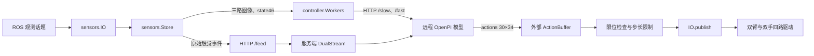

# TIP 模型与硬件桥接接口文档

本文根据本目录 `tip_bridge/`、`scripts/`、`config/` 及配套硬件契约整理，核对日期：2026-11-03。面向模型服务、ROS 驱动及桥接层开发人员；部署启动说明见 [README.md](README.md)。文中数组切片均采用 Python 的左闭右开下标。

## 1. 职责与模块入口

桥接层订阅双臂、双手、三路相机和十四块触觉数据，组装模型观测，通过 HTTP 获取动作，再发布到现有驱动。桥接层不直接连接硬件 SDK，也不管理硬件进程。



| 文件 | 主要接口及职责 |
| --- | --- |
| [tip_bridge/contracts.py](tip_bridge/contracts.py) | ROS 数据解码、图像处理、关节顺序、动作拆分、机械臂限位 |
| [tip_bridge/sensors.py](tip_bridge/sensors.py) | `Store` 数据缓存与对齐；`IO` ROS 订阅、发布、就绪检查与停止 |
| [tip_bridge/common.py](tip_bridge/common.py) | `rpc`、`pack`、`vector`、`project`、`limited`、`Stable` |
| [tip_bridge/controller.py](tip_bridge/controller.py) | 观察、复位、影子推理和执行推理；`Workers` 触觉上传与模型调用 |
| [tip_bridge/stream.py](tip_bridge/stream.py) | `DualStream` 因果触觉采样、首 16 帧校准与特征生成 |
| [tip_bridge/server.py](tip_bridge/server.py) | 带 Bearer 认证的 HTTP 模型适配服务 |
| [tip_bridge/config.py](tip_bridge/config.py) | 配置加载、路径解析、三路相机绑定 |
| [tip_bridge/inspect_config.py](tip_bridge/inspect_config.py) | 离线配置检查入口，不创建 ROS 节点、不请求模型 |
| [tip_bridge/runtime.py](tip_bridge/runtime.py) | 模型服务启动时安装注解检查优化，不提供业务接口 |

部署目标为 Ubuntu 24.04、ROS 2 Jazzy、Python 3.12。`infer` 额外依赖匹配 checkpoint 的 `openpi.fastslow.buffer`；模型服务还依赖原模型环境、JAX/CUDA、权重及触觉特征代码。这些实现未包含在桥接目录内。

## 2. 统一数据契约

### 2.1 模型标识与向量布局

| 项目 | 值 |
| --- | --- |
| `schema` | `sandisk100_dual_o10_v1` |
| 状态 | `state`，形状 `(46,)`，有限数值 |
| 部署动作 | 单帧 `(34,)`；模型返回动作块 `(30, 34)` |
| 模型内部动作 | 48 维，由原模型处理，不直接发布到驱动 |
| 触觉布局 | `dualhand_430` |
| 控制频率 | `FPS = 29.994` Hz；循环通过 `sleep(1/FPS)` 调度，不保证硬实时 |
| 固定任务提示 | `Pour water.`；当前 HTTP 请求不开放 prompt 切换 |

`q34` 与 `state[:34]` 使用相同布局：

| 切片 | 含义 | 单位 |
| --- | --- | --- |
| `0:6` | 左臂 `joint1`～`joint6` | rad |
| `6` | 左臂 `joint7` 占位，必须为 0 | — |
| `7:17` | 左手 10 个主动关节 | rad |
| `17:23` | 右臂 `joint1`～`joint6` | rad |
| `23` | 右臂 `joint7` 占位，必须为 0 | — |
| `24:34` | 右手 10 个主动关节 | rad |
| `state[34:40]` | 左末端 `[x, y, z, roll, pitch, yaw]` | 前三项 m，后三项 rad |
| `state[40:46]` | 右末端 `[x, y, z, roll, pitch, yaw]` | 前三项 m，后三项 rad |

向量不允许 NaN/Inf。动作及机械臂反馈的占位槽允许绝对误差不超过 `1e-4`，随后归零。末端位置沿用驱动坐标系；桥接不做 TF 变换，`frame_id` 不参与状态计算。

### 2.2 手部关节顺序

双手均使用以下顺序，左右手的符号与限位分别读取硬件契约：

```text
0 thumb_roll     1 thumb_abad    2 thumb_mcp
3 index_abad     4 index_pip     5 middle_pip
6 ring_abad      7 ring_pip      8 pinky_abad     9 pinky_pip
```

唯一运行时来源为 [omnihand_o10_contracts/joints.py](../hardware/hand_ws/src/collection/o10_contracts/omnihand_o10_contracts/joints.py) 中的 `ACTIVE_JOINT_NAMES`、`JOINT_LIMITS`。集成代码应导入该契约，避免自行维护一套名称或限位。

### 2.3 图像与触觉布局

模型相机键固定为 `top`、`left_wrist`、`right_wrist`。源图先按相机 YAML 的宽高校验，转 RGB，保持比例缩放并居中补黑边至 `224×224`，再以质量 90 编码为 JPEG。`Store` 保存的是一维 `uint8` JPEG 字节数组。

触觉按左手在前、右手在后排列；每手七块：

| 手内索引 | patch 路径 | 原生形状 `(height, width)` | 左手全局索引 | 右手全局索引 |
| --- | --- | --- | --- | --- |
| 0 | `back` | `(11, 12)` | 0 | 7 |
| 1 | `palm` | `(14, 15)` | 1 | 8 |
| 2 | `thumb/distal` | `(8, 2)` | 2 | 9 |
| 3 | `index/distal` | `(9, 2)` | 3 | 10 |
| 4 | `middle/distal` | `(9, 2)` | 4 | 11 |
| 5 | `ring/distal` | `(9, 2)` | 5 | 12 |
| 6 | `pinky/distal` | `(9, 2)` | 6 | 13 |

每手有效像素数为 430。上传的是原始 `mono8` 矩阵，服务端再调用 OpenPI 的校准和特征函数；桥接不将触觉拼入 `state46`。

## 3. ROS 接口

### 3.1 输入话题

下表 `{side}` 为 `left` 或 `right`，`{patch}` 为上表路径。

| 话题 | 消息类型 | 桥接读取字段与约束 |
| --- | --- | --- |
| `/observation/{side}_arm/joint_states` | `sensor_msgs/msg/JointState` | `header.stamp`、`name`、`position`；7 槽，rad，第 7 槽为零 |
| `/o10/{side}/joint_states` | `sensor_msgs/msg/JointState` | 10 槽，rad；空 `name` 按固定契约顺序解释 |
| `/observation/{side}_arm/pose` | `geometry_msgs/msg/PoseStamped` | `pose.position` 与 `pose.orientation`；四元数按 `x,y,z,w` 解码为 RPY |
| `/o10_control/{side}/state` | `rokoko_omnihand_msgs/msg/O10ControlState` | 手部驱动状态与指令时间，见下表 |
| `/observation/{side}_hand/tactile/{patch}` | `sensor_msgs/msg/Image` | `encoding=mono8`、原生宽高、`step`、`data`；允许行尾 padding |
| 相机 YAML 的 `compressed_topic` | `sensor_msgs/msg/CompressedImage` | `format` 包含 `jpeg`、`jpg` 或 `png`，读取 `data`、采集时间及 `frame_id` |

关节反馈若携带 `name`，名称必须完整、无重复且集合正确，桥接据此重排；空 `name` 使用固定顺序，此行为同时适用于机械臂和手部。`velocity`、`effort` 不参与观测。

末端四元数模长与 1 的差不得超过 `0.01`。触觉要求 `step >= width` 且 `len(data) == height * step`，解码时去掉行尾 padding。

当前默认相机绑定由 [hardware/cameras_ws/config.yaml](../hardware/cameras_ws/config.yaml) 解析，不能在集成代码中写死：

| 模型角色 | YAML 相机名称 | 当前压缩图话题 | 当前源分辨率 |
| --- | --- | --- | --- |
| `top` | `head` | `/observation/head/images/compressed` | `640×480` |
| `left_wrist` | `left_wrist` | `/observation/left_wrist/images/compressed` | `640×480` |
| `right_wrist` | `right_wrist` | `/observation/right_wrist/images/compressed` | `640×480` |

三个角色必须绑定三个不同、唯一且启用的相机，压缩图话题也必须互不相同。当前接口不订阅相机内参或深度图。

手部状态消息完整定义见 [O10ControlState.msg](../hardware/hand_ws/src/collection/ros_interfaces/msg/O10ControlState.msg)。桥接实际检查以下字段：

| 字段 | 检查逻辑 |
| --- | --- |
| `header.stamp`、`side` | 状态默认不超过 0.5 s，`side` 必须与话题一致 |
| `fault_latched`、`fault_reason_mask`、`phase` | 任一故障标志非零或 `phase == 5` 时阻断 |
| `feedback_ready`、`error_monitor_ready`、`motion_enabled` | 三项均为真才允许通过就绪检查 |
| `target_result` | `check(prepared=True)` 时若 `>= 3`，视为目标被拒绝 |
| `command_time_available`、`last_command_sent_stamp` | 复位完成检查时，要求指令时间晚于本次使能时间 |

### 3.2 输出话题

四路均为 `sensor_msgs/msg/JointState`，`position` 表示绝对位置目标，单位 rad。

| 顺序 | 话题 | `name` | `position` 来源 |
| --- | --- | --- | --- |
| 0 | `/observation/left_arm/joint_cmd` | `joint1`～`joint7` | `q34[:7]` |
| 1 | `/observation/right_arm/joint_cmd` | `joint1`～`joint7` | `q34[17:24]` |
| 2 | `/o10_control/left/command` | 10 个主动关节，固定顺序 | `q34[7:17]` |
| 3 | `/o10_control/right/command` | 10 个主动关节，固定顺序 | `q34[24:34]` |

每次先构造全部消息，再顺序发布；四路共用一个 ROS 时间戳，要求该时间严格晚于上次发布时间和本次使能时间。`velocity`、`effort` 留空，`header.frame_id` 使用消息默认值。同时间戳不保证四个驱动原子或同步执行。

`IO` 初始化只创建订阅者。`enable()` 才创建输出发布器，等待每个指令话题**恰好一个**订阅者，最长 2 s；同时检查是否存在其他指令发布节点。首次实际 `publish()` 可能立即触发运动。

### 3.3 QoS 与时间对齐

普通传感器订阅使用 `depth=1`、`BEST_EFFORT`；手部状态订阅传入深度 `10`，使用 rclpy 默认可靠性；输出发布器传入深度 `1`，使用 rclpy 默认可靠性。实际 DDS 匹配应在目标 ROS 环境验证。

全部输入必须携带正的源时间戳。桥接先计算 ROS 源时间相对于当前 ROS 时钟的包龄，再转换为本机单调时钟；不能直接用 epoch 秒与 `time.monotonic()` 比较。源时间领先当前 ROS 时间超过默认 2 ms 时拒绝；重复源时间忽略；源时间倒退将锁定会话错误，需重启桥接会话，相机倒退还会清空三路图像配对缓存。

`Store.snapshot()` 以新鲜 `top` 帧为锚点，从新到旧尝试匹配：

1. 锚点包龄不超过 `camera_max_age_s`，默认 100 ms。
2. 两路腕部均已收到时间不早于锚点的帧，再各选距锚点最近的一帧；选中帧也需满足包龄限制。
3. 三路时间戳极差不超过 `camera_sync_tolerance_s`，默认 100 ms。
4. 关节和末端状态均在锚点处取精确样本或线性插值，不进行外推；插值两端距锚点各不超过 `state_bracket_s`，默认 100 ms。RPY 入库前先展开角度跳变。

返回 `(images, state46, anchor_monotonic_s)`。原始相机时间、角色、`frame_id`、格式和选中单调时间另存于 `Store.snapshot_metadata`，不随 `/slow` 上传。`IO.check()` 另外要求最新关节反馈默认不超过 150 ms。坏图会被丢弃并记录 `camera_frame_dropped`，不会更新有效图像缓存。

## 4. HTTP 模型接口

### 4.1 通用协议

默认基址为配置中的 `http://192.168.101.6:18774`。客户端 `rpc()` 支持 HTTP/HTTPS；本目录 `server.py` 启动的是普通 HTTP 服务，默认监听 `0.0.0.0:18774`。

- 全部路由要求 `Authorization: Bearer <token>`。token 从指定文件读取并去除首尾空白，禁止空值。
- JSON 请求由 `rpc(route, data=...)` 发送，带 `Content-Type: application/json`；`/slow` 发送原始 NPZ 字节，不是 multipart，当前 `rpc(body=...)` 不显式设置 Content-Type。
- 响应统一为 JSON。成功 `200`；认证失败 `401`、`{"error":"Unauthorized"}`；未知 GET 路由 `404`、`{}`；POST 解析或执行异常 `400`、`{"error":"异常类型: 说明"}`，未知 POST 路由也为 `400`。
- POST 要求 `0 < Content-Length < 8*1024*1024`；`/feed` 每批最多 1024 条事件。
- `rpc()` 默认超时 3 s，每线程复用 HTTP 连接。失败后关闭连接并抛 `RuntimeError`；不会自动重发结果不明的 POST，避免重复接受数据或重复推理。
- `/slow`、`/fast` 通过单线程推理执行器串行执行；当前服务共享一个 Policy 会话状态，`/reset` 会重置它，不能当作多个桥接客户端相互隔离的服务。

HTTP 中的 `timestamp`、`anchors` 及触觉时间都使用**桥接客户端的单调时钟秒**，服务端应按同一观测时间域消费；不得替换为服务端自己的单调时钟或 ROS epoch 时间。日志 `monotonic` 则属于产生日志的本机。

### 4.2 `GET /status`

无需请求体。返回的主要字段：

| 字段 | 约定或说明 |
| --- | --- |
| `ready` | 服务预热后为 `true` |
| `schema` | `sandisk100_dual_o10_v1` |
| `state_dim` / `physical_action_dim` / `model_action_dim` | `46` / `34` / `48` |
| `checkpoint` / `tactile_layout` | 权重路径 / `dualhand_430` |
| `fps` / `max_delay_frames` | `29.994` / `8` |
| `slow_steps` / `fast_steps` / `prompt` | `6` / `4` / `Pour water.` |
| `tactile_policy` | 见下方默认策略 |
| `warmup` | 5 轮预热记录，各含 `slow_ms`、`fast_ms`、`total_ms` |
| `live_budget_ok` | 后三轮预热总耗时均小于 `8/FPS*1000 - 15` ms，约 251.7 ms |
| `pid` / `robot_control` | 服务进程号 / `false`，模型服务自身不控制硬件 |

默认 `hold` 策略：

```json
{
  "sampling": "latest_causal_packet",
  "max_sample_age_s": null,
  "stream_timeout_s": null,
  "fallback": "hold_last_causal_packet",
  "fallback_after_s": 0.15
}
```

`infer()` 校验 schema、三项维度、`ready`，执行模式额外要求 `live_budget_ok`；并逐项核对触觉策略中的 `sampling`、`max_sample_age_s`、`stream_timeout_s`、`fallback_after_s`。当前客户端不单独比较 `fallback` 字段。

### 4.3 `POST /reset`

创建新模型会话并指定触觉校准锚点，**不会复位机器人**。

```json
{"anchors": [100.0, 100.0333400013, 100.0666800027, 100.100020004, 100.1333600053, 100.1667000067, 100.200040008, 100.2333800093, 100.2667200107, 100.300060012, 100.3334000133, 100.3667400147, 100.400080016, 100.4334200173, 100.4667600187, 100.50010002]}
```

`anchors` 为 16 个有限、严格递增的相机锚点秒值；实际取本次 `Store` 接收的前 16 个 `top` 有效帧时间。响应：`{"session_id":"<新会话ID>"}`。后续请求必须使用此 ID。

### 4.4 `POST /feed`

上传原生触觉矩阵。以下为包含单块 `(8,2)` 拇指触觉的合法字段示例；真实启动需要提供全部十四块的历史：

```json
{
  "session_id": "<会话ID>",
  "frames": [{
    "sequence": 1,
    "patch": 2,
    "timestamp": 100.0,
    "valid": true,
    "raw": [[0,0],[0,0],[0,0],[0,0],[0,0],[0,0],[0,0],[0,0]]
  }]
}
```

| 字段 | 类型与约束 |
| --- | --- |
| `session_id` | 当前模型会话 ID |
| `frames` | 事件列表，长度不超过 1024；桥接客户端每批最多发送 512 条 |
| `patch` | Python/JSON 整数，范围 `0..13`，不接受布尔值 |
| `raw` | 对应该块原生宽高的二维整数矩阵，范围 `0..255` |
| `timestamp` | 有限秒值；每个 patch 内必须严格递增，重复上传会被拒绝 |
| `valid` | 可选布尔值，默认 `true`；当前 ROS 上传链不主动附加该字段 |
| `sequence` | 客户端事件游标，服务端不使用；客户端仅在成功响应后推进游标 |

响应示例：`{"accepted":1,"calibrated":false}`。`accepted` 表示本次列表长度，`calibrated` 表示基线已生成。`feed()` 按条更新，接口未提供批次事务回滚；中途失败或连接结果不明时应结束会话并重新校准，不盲目重放整批。

### 4.5 `POST /slow`

请求体为 `numpy.savez` 生成的 NPZ，服务端使用 `allow_pickle=False` 加载：

| NPZ 键 | 形状/类型 | 说明 |
| --- | --- | --- |
| `session` | 标量字符串数组 | 注意此处键为 `session`，不是 `session_id` |
| `timestamp` | 标量浮点数 | 选中 `top` 锚点的单调时间秒 |
| `state` | `(46,)` 数值数组 | 在该锚点对齐的状态 |
| `top` / `left_wrist` / `right_wrist` | `(N,) uint8` 或 `(224,224,3) uint8` | JPEG 字节或 RGB 图像；当前客户端发送 JPEG |

服务端将三路图像转为 RGB，并固定向模型传入 `camera_valid=[true,true,true]`、`prompt='Pour water.'`。桥接不发送相机缺失占位。`state46` 在客户端组装时检查，服务端具体模型校验由外部 Policy 实现。

响应透传 `policy.slow()` 的字段，当前客户端必须读取 `chunk_id`、`slow_ms`，服务包装器额外附加 `server_wall_ms`。`chunk_id` 原样用于下一次 `/fast`。外部 Policy 可能返回其他字段，桥接不为其定义额外契约。

### 4.6 `POST /fast`

```json
{"session_id":"<会话ID>","chunk_id":1,"timestamp":100.65,"executed_steps":0}
```

`timestamp` 为当前客户端单调时间，`chunk_id` 来自 `/slow`；`executed_steps` 可省略，默认 0，当前桥接始终传 0。

响应透传 `policy.fast()` 并附加 `server_wall_ms`。当前桥接消费及离线测试约定的字段如下：

| 字段 | 含义 |
| --- | --- |
| `session_id`、`chunk_id` | 会话与动作块标识 |
| `revision` | 动作块修订标识，由外部 ActionBuffer 解释 |
| `observation_time` | 动作块对应观测时间；桥接用于动作时域耗尽检查 |
| `sensor_time` | 传感器时间元数据，由外部 ActionBuffer 解释 |
| `actions` | `(30,34)` 有限数值数组，绝对关节位置，rad |
| `valid_from` | 有效动作起始下标；桥接对 `actions[valid_from:]` 做手部裁剪与限位校验 |
| `fps` | 动作采样频率，部署为 `29.994` |
| `fast_ms` | 模型快推理耗时 |
| `server_wall_ms` | 服务执行器内本次调用耗时；不含排队与网络传输 |

实际构造使用 `ActionUpdate(**{k: fast[k] for k in ActionUpdate.__dataclass_fields__})`，因此生产响应必须覆盖所安装 OpenPI 版本的全部 dataclass 字段。桥接目录没有外部 `ActionUpdate` 源码；上述字段由本地消费者和 Mock 测试核对，版本迁移时必须再对照匹配的 OpenPI 实现。`server_queue_ms`、`server_handler_ms`、`server_read_ms`、`server_decode_ms` 仅为客户端可选诊断字段，本目录服务未生成它们。

### 4.7 一次推理的调用顺序

1. 启动硬件、收集新鲜反馈与首 16 个相机锚点，检查 `/status`。
2. `/reset` 创建会话。
3. 持续 `/feed` 按序上传触觉，等待 `calibrated=true`。
4. 获取新相机/状态快照，等待触觉上传追上锚点；完成校准后，若已上传全部本地事件且因果历史存在，可按策略复用暂停的触觉源。
5. `/slow` 获取 `chunk_id`，再 `/fast` 获取动作块。
6. 相对观测锚点的耗时超过 `8/FPS`（约 266.7 ms）时丢弃结果；否则调用外部 `ActionBuffer.apply()`。
7. 控制循环消费缓冲动作，经限位与步长处理后发布。缓冲时间达到 `observation_time + 30/FPS`（约 1.0002 s）且未有新块续接时退出推理。

`/feed` 与推理分别在线程中运行。第一轮上传追齐等待上限为 5 s，后续为 0.1 s；校准等待上限为 5 s；控制器等待首个可用推理结果上限为 7 s。耗尽或错误退出会进入停止清理。

## 5. 内部 Python 接口

这些接口是当前源码中的集成点，未声明跨版本稳定性。`CONFIG` 在模块导入时加载；影响全局常量的环境变量应在启动进程前设置。

### 5.1 转换与约束函数

| 接口 | 输入 → 返回 | 失败或副作用 |
| --- | --- | --- |
| `config.load_config(path=None, deployment_root=None)` | 配置文件/根目录 → 配置字典，附 `deployment_root: Path` | 校验正数、触觉模式、相机角色等；文件/JSON/字段错误直接抛出 |
| `config.camera_bindings(cfg)` | 配置 → `{角色: {topic,width,height,name}}` | 相机缺失、重复、禁用或格式错误时 `ValueError` |
| `contracts.joint_feedback(msg, *, arm, hand_names=())` | JointState → 固定顺序的 7/10 维数组 | 错名、非有限值、错误维度或占位非法时拒绝 |
| `contracts.pose_vector(msg)` | PoseStamped → `(6,)` 的 `[xyz,RPY]` | 校验有限值与四元数模长 |
| `contracts.decode_tactile(msg, index)` | Image、patch 索引 → 原生二维 `uint8` 数组副本 | 编码、宽高、步长或字节长度不符时拒绝 |
| `contracts.model_image(data, binding)` | 压缩图 bytes、相机绑定 → 一维 `uint8` JPEG | 校验源宽高，缩放补边到 224；坏图抛异常 |
| `contracts.split_action(q, hand_names)` | q34 → 四项 `(names, values)` 元组 | 顺序为左臂、右臂、左手、右手；只做维度、有限值和占位校验 |
| `contracts.arm_limits(path)` | URDF 路径 → `(lower6, upper6)` | URDF 限位与 RM65 参考限位取交集；非法交集拒绝 |
| `common.vector(value, n)` | 输入值 → `(n,) float64` | 维度或有限值不符时 `ValueError` |
| `common.q34(pose)` | 复位 JSON 字典 → q34 | `arm_deg` 转 rad，`hand_rad` 保持原值 |
| `common.project(q, limits, *, feedback=False)` | q34、双侧限位 → 校验后的数组副本 | 越界时抛异常；名称虽为 project，实际不会把越界动作整体裁回边界 |
| `common.limited(target, previous, limits)` | 目标、上次目标 → 步长受限 q34 | 每 tick 臂关节最大 0.02 rad、手部最大 0.025 rad，手部结果裁入限位 |
| `common.pack(**fields)` | NumPy 可序列化字段 → NPZ bytes | 使用 `np.savez`，不是 `savez_compressed` |
| `common.rpc(route, data=None, body=None, timeout=3)` | 路由、JSON 或 bytes → 解析后的 JSON | 无 body 为 GET，有 body 为 POST；非 200/通信失败抛 `RuntimeError` |
| `common.Stable(target, duration=4.).update(q, stamp)` | q34、单调时间 → 是否稳定 | 误差须全维不超过 0.05 rad、窗口内峰峰值小于 0.01 rad；反馈间隔超过 0.15 s 清窗 |

`limits` 结构为 `{side: {'arm': (lower6,upper6), 'hand': (lower10,upper10)}}`。`project(feedback=True)` 仅对实测值容忍机械臂 `1e-4` rad、手部 `0.03` rad 的限位误差；动作目标仍按严格限位校验。推理返回的有效手部预测先裁入原生限位，机械臂预测越界直接拒绝。

### 5.2 `sensors.Store`

| 方法/属性 | 契约 |
| --- | --- |
| `Store(config=None)` | 建立可重入锁、相机/状态队列、触觉事件队列；不启动 ROS |
| `add(key, value, stamp, metadata=None)` | key 为三相机角色或 `la/lh/ra/rh/lp/rp`；保存数组副本；时间递增返回 `True`，重复返回 `False`，倒退拒绝 |
| `patch(index, raw, stamp)` | 添加触觉事件并生成递增 `sequence`；每 patch 重复时间忽略，倒退拒绝；原生形状在上游解码检查 |
| `after(sequence)` | 返回游标之后的事件列表；落后于已淘汰事件则抛队列溢出错误 |
| `latest(key, now, age=None)` | 返回新鲜的最新数组副本；默认包龄阈值为 `joint_max_age_s` |
| `joints()` | 返回最新 `la+lh+ra+rh`，共 34 维；内部加锁 |
| `continuous(key, stamp)` | 精确采样或线性插值；无两侧样本或跨度过大时拒绝 |
| `snapshot()` | 返回 `(images, state46, stamp)`；无完整、新鲜的对齐观测时 `ValueError` |
| `anchors` | 前 16 个有效 `top` 帧单调时间，作为模型会话校准锚点 |
| `snapshot_metadata` | 最近一次成功快照的三路元数据 |
| `error` | 输入故障锁存原因，由 `IO.check()` 拦截 |

每路相机/状态缓存最多 512 条，触觉事件最多 12000 条。`add/patch/after/joints/snapshot` 内部持锁；外部直接调用 `latest/continuous` 或访问共享队列时应持有 `store.lock`。

### 5.3 `sensors.IO`

| 方法 | 返回与行为 |
| --- | --- |
| `IO(config=None)` | 创建 ROS 节点 `tip_model_bridge_<pid>`、订阅、执行器与三路图像处理线程；每相机待处理队列只保留最新一项 |
| `check(prepared=False)` | 检查锁存错误、手部状态与最新关节，返回 q34；`prepared=True` 额外要求输出使能、目标未拒绝 |
| `tactile_health()` | 要求双手均存在真实因果历史；strict 模式超时拒绝，hold 模式记录复用状态 |
| `conflicts()` | 检查四路指令话题是否有其他节点发布者；存在则 `ValueError` |
| `enable()` | 检查就绪和冲突，创建四路发布器，等待唯一订阅者并记录执行时间边界；不发布动作 |
| `hands_acked()` | 返回 bool；要求双臂反馈晚于使能，双手均报告晚于使能的指令发送时间 |
| `publish(q)` | 验证使能和反馈、检查限位，将臂目标限制在实测值 ±`arm_feedback_lead_rad`，再发布四路目标 |
| `stop()` | 已使能时停止后续输出，尝试各发一次新鲜实测手部保持目标；不向机械臂发布停止消息 |
| `close()` | 调用 stop，关闭执行器、图像线程、ROS 节点和 rclpy 上下文 |

`publish()` 本身不调用 `limited()`，直接集成的调用者需要自行安排步长限制。`IO` 会初始化并关闭 rclpy 上下文，嵌入已有 ROS 进程时需评估上下文管理方式，不能视作完全无副作用的库对象。

### 5.4 `controller.Workers` 与模式入口

| 接口 | 契约 |
| --- | --- |
| `ready(io, timeout=10)` | 循环检查停止标记和 `io.check()`，返回限位校验后的实测 q34；超时抛 `TimeoutError` |
| `aligned_snapshot(io, timeout=5)` | 等待完整对齐观测，返回与 `Store.snapshot()` 相同的三元组；超时重抛观测错误 |
| `reset(args, io)` | args 使用 `execute`、`reset_timeout`；读取复位文件并执行第 6 节描述的分阶段复位或只读检查 |
| `infer(args, io)` | args 使用 `execute`、`duration`；核对远程契约、启动 Workers、循环消费动作，finally 中停止输出并关闭 Workers |
| `Workers(io, current)` | current 为当前 q34；导入外部 ActionBuffer，并立即调用 `/reset`，因此构造时就会建立远程新会话 |
| `Workers.start()` | 启动 `feed()` 与 `model()` 两个 daemon 线程 |
| `Workers.feed()` | 批量上传 `store.after(sequence)`，响应成功后推进 `sequence/fed`，校准完成后设置 `calibrated` Event |
| `Workers.feed_aligned_snapshot(last, timeout)` | 选择时间晚于 last 的新鲜观测，等待触觉追齐；返回 `(images,state,stamp,feed_wait_ms)`，停止时可返回 `None` |
| `Workers.model()` | 等待校准，循环 slow/fast、丢弃过期结果并应用缓冲；首个结果成功后设置 `ready` Event |
| `Workers.fail(e)` | 保存字符串错误到 `error` 并设置 `stop` Event，供控制循环读取 |
| `Workers.close()` | 设置停止 Event，并对工作线程分别 join，单线程等待上限 3 s |

共享状态主要包括 `session`（模型会话 ID）、`buffer`（外部 ActionBuffer）、`sequence`（已上传游标）、`fed`（已上传最大触觉时间）、`updates/discarded`（接受/丢弃块数）、`error`（工作线程失败原因）。访问缓冲的 apply/next_action 路径由 `buffer.lock` 保护。停止线程不等于取消已由模型服务接受的 HTTP 请求。

### 5.5 `stream.DualStream`

| 接口 | 契约 |
| --- | --- |
| `DualStream(targets=None)` | 可指定 16 个递增校准锚点；十四块触觉分别保留最多 1000 包 |
| `reset()` | 清空历史与校准结果，同时清除 targets |
| `update(patch, raw, stamp, valid=True)` | 校验索引、原生尺寸、整数范围、有效标志及严格递增时间；满足条件后调用 `calibrate_dualhand()` |
| `sample(targets)` | 返回 `(raw, valid, latest)`，形状分别为 `(14,T,14,15)`、`(14,T)`、标量；原生矩阵放在左上角，其余补零，无有效末采样时间时 `latest=-inf` |
| `snapshot(stamp)` | 采样 `stamp + arange(-15,1)/FPS` 的 16 个时刻，调用 `dualhand_contact_fields()`；返回 `(fields, max_causal_timestamp)` |

`fields` 的具体结构由匹配 OpenPI 的触觉函数决定，本桥接层未声明额外形状。启动校准需十四块都已收到覆盖最后校准锚点的历史，再按各锚点因果采样。不能用另一只手的数据填补缺失历史。

默认 `hold` 选目标时刻之前最近一包，超过 150 ms 切换为复用标记，但没有持有时长上限。`valid=false` 的最新包保持无效掩码，不回退到更早的有效包。未来包不能满足当前采样或历史要求。`strict` 模式默认样本包龄上限 50 ms，整手流超时 150 ms；两端配置必须一致。

## 6. 命令行接口与生命周期

以下命令均在 Linux 的 `TIP_demo_deploy` 根目录执行。

| 命令 | 行为 |
| --- | --- |
| `bash model_hardware_bridge/scripts/bridge.sh check` | 离线检查相机映射、臂限位与复位臂目标，输出 JSON；不验证模型在线或手部运行状态 |
| `bash model_hardware_bridge/scripts/bridge.sh model-status` | 认证访问 `/status` 并打印 JSON |
| `bash model_hardware_bridge/scripts/bridge.sh observe --duration 5` | 只读观察并输出状态；duration 默认 0，在 observe 中等效观察 5 s |
| `bash model_hardware_bridge/scripts/bridge.sh reset` | 检查反馈并打印实测、目标、误差，不发布动作 |
| `bash model_hardware_bridge/scripts/bridge.sh reset --execute --confirm-motion` | 实际复位 |
| `bash model_hardware_bridge/scripts/bridge.sh infer --duration 10` | 影子推理：真实调用模型、消费动作，但不创建输出发布器 |
| `bash model_hardware_bridge/scripts/bridge.sh infer --execute --confirm-motion --duration 30` | 执行推理 |
| `bash model_hardware_bridge/scripts/bridge.sh stop` | 写入 `runs/STOP`，请求当前控制器停止；不关闭模型或硬件进程 |

控制器参数：`--duration` 默认 `0`，必须有限且非负，在 infer 中为持续运行直到停止/错误；`--reset-timeout` 默认 `60` s，必须有限且为正。`--execute` 只允许 reset/infer，并必须同时带 `--confirm-motion`。

控制器通过 `runs/controller.lock` 的 `fcntl.flock` 防止同目录多个控制器并行，新会话启动会清除旧 STOP 文件。SIGTERM 设置 STOP，Ctrl-C 进入清理流程。模式执行正常返回 0；捕获 KeyboardInterrupt 返回 130；运行中异常记录 `controller_blocked` 并返回 2。参数错误通常由 argparse 返回 2，锁冲突和初始化前错误可能直接退出。

实际复位阶段为：先以当前位置保持双手并移动双臂，稳定 0.5 s 后等待 1 s，再将双手移向目标；全 34 维满足稳定条件持续 4 s 且手部指令时间反馈通过后，输出 `reset_complete`。执行推理启动前还要求处于保存的采集复位姿态并稳定 4 s；影子推理不要求该复位姿态，但仍要求新鲜反馈、首 16 个锚点与触觉校准。

**反馈与停止的边界：**机械臂接收端没有 prepare/enable/stop 服务、接受确认或聚合故障话题。`hands_acked()` 仅验证本次手部指令发送时间与新双臂位置反馈；`reset_complete` 不代表机械臂动作 ACK。停止后机械臂依赖现有驱动 `target_timeout_sec`（默认 0.3 s）减速，双手保持目标仅为尽力发送；这不提供同步急停保证。退出不会自动复位，也不会自动清除硬件锁存故障。

模型服务入口：

```bash
bash model_hardware_bridge/scripts/model_server.sh --host 0.0.0.0 --port 18774
```

该脚本使用已有模型环境，不安装依赖；`--host`、`--port` 默认如上。服务检查 checkpoint 的 `assets/fastslow.json`，要求 `action_dim=48`、`loss_action_dims=list(range(34))`、`tactile_layout=dualhand_430`，完成 5 轮预热后才监听端口。SIGTERM/SIGINT 关闭 HTTP 服务并等待推理执行器退出。

## 7. 配置接口

### 7.1 bridge.json

默认文件为 [config/bridge.json](config/bridge.json)。`load_config()` 不自动补齐缺失键；复制配置时应保留完整结构。

| 键 | 当前默认值 | 用途 |
| --- | --- | --- |
| `model_url` | `http://192.168.101.6:18774` | 模型基址 |
| `token_file` | `config/token` | 相对桥接根目录的 token 路径 |
| `checkpoint` | 见配置中的完整路径，末级为 `23000` | 模型服务权重路径；配置检查不加载权重 |
| `camera_config` | `hardware/cameras_ws/config.yaml` | 相对部署根目录的相机配置 |
| `camera_roles` | `top→head`，两腕同名 | 模型角色到 YAML 名称映射 |
| `arm_urdf` | `hardware/arm_ws/rm_65.urdf` | 相对部署根目录的机械臂 URDF |
| `reset_file` | `config/reset.json` | 相对桥接根目录的复位配置 |
| `startup_timeout_s` | `10.0` | infer 初始就绪与锚点/姿态等待等 |
| `camera_max_age_s` | `0.1` | 相机最大包龄 |
| `camera_sync_tolerance_s` | `0.1` | 三路相机时间极差 |
| `joint_max_age_s` | `0.15` | 最新关节反馈包龄 |
| `state_bracket_s` | `0.1` | 插值两端到目标的最大时间差 |
| `driver_state_max_age_s` | `0.5` | 手部状态最大包龄 |
| `source_future_tolerance_s` | `0.002` | 输入源时间允许领先当前 ROS 时间的阈值 |
| `arm_feedback_lead_rad` | `0.06` | 机械臂目标相对实测位置的最大领先/落后量，配置不得超过 0.06 |
| `tactile_mode` | `hold` | `hold` 或 `strict` |
| `tactile_fallback_after_s` | `0.15` | 触觉复用状态标记阈值 |
| `tactile_strict_sample_age_s` | `0.05` | strict 单样本有效期 |
| `tactile_strict_timeout_s` | `0.15` | strict 整手超时 |

上述数值阈值均要求有限、严格为正且不能为布尔值。配置文件位置改变不会改变桥接根目录：`token_file/reset_file` 仍相对固定 `ROOT`，`camera_config/arm_urdf` 仍相对解析后的 `deployment_root`；绝对路径可直接使用。

复位文件的 `arm_deg.left/right` 各 6 项，`hand_rad.left/right` 各 10 项；臂角转换为 rad 并插入两个零占位。`source`、`source_sha256` 等为来源记录，不会读取 `source` 中的旧文件路径。

### 7.2 环境变量

| 变量 | 作用/优先级 |
| --- | --- |
| `TIP_BRIDGE_CONFIG` | 覆盖默认 bridge.json；显式 `load_config(path=...)` 优先 |
| `TIP_DEPLOY_ROOT` | 覆盖默认 `ROOT.parent`；显式 `deployment_root=...` 优先 |
| `TIP_MODEL_URL` | 优先于旧兼容变量 `POUR_MODEL_URL`，再优先于配置值 |
| `TIP_MODEL_TOKEN_FILE` | 覆盖 `ROOT / token_file`；客户端和服务端需使用相同 token |
| `TIP_MODEL_CHECKPOINT` | 覆盖配置权重路径 |
| `TIP_BRIDGE_PYTHON` | bridge.sh 的 Python，默认 `/usr/bin/python3` |
| `ROS_SETUP` | ROS setup 路径，默认 `/opt/ros/jazzy/setup.bash` |
| `TIP_OPENPI_SRC` | 加入 Python 搜索路径；客户端脚本校验含 `openpi/fastslow/buffer.py` |
| `TIP_OPENPI_CLIENT_SRC` | 模型服务使用的 OpenPI client 源码搜索路径 |
| `TIP_MODEL_PYTHON` | 模型服务 Python，默认 `python3` |
| `OMP_NUM_THREADS` | 模型脚本默认 `4`，可由环境覆盖 |
| `CUDA_VISIBLE_DEVICES` | 由模型环境选择 GPU，脚本直接继承 |

模型脚本固定设置 `XLA_PYTHON_CLIENT_PREALLOCATE=false`。配置检查、observe 和 reset 不读取模型 token；infer、model-status 和模型服务需要 token。token 文件已被 `.gitignore` 忽略，不应写进文档或示例。

## 8. 可复用调用示例与排障

以下 Python 片段在桥接根目录、已配置环境变量和依赖的前提下运行。它展示与模型的请求封装，不发布硬件指令；`store` 代表已接收传感器数据的 `Store` 实例，`frames` 为其待上传事件列表。

```python
import numpy as np
from tip_bridge.common import pack, rpc

status = rpc('/status')
session_id = rpc('/reset', {'anchors': store.anchors})['session_id']
feed_result = rpc('/feed', {'session_id': session_id, 'frames': frames})
# 实际调用方需继续上传全部十四块历史，直至 calibrated=true。
if not feed_result['calibrated']:
    raise RuntimeError('触觉校准尚未完成，继续上传后再推理')

images, state, stamp = store.snapshot()
slow = rpc('/slow', body=pack(
    session=np.asarray(session_id), state=state, timestamp=stamp, **images))
import time
fast = rpc('/fast', {
    'session_id': session_id, 'chunk_id': slow['chunk_id'],
    'timestamp': time.monotonic(), 'executed_steps': 0,
})
actions = np.asarray(fast['actions'])  # 预期 (30, 34)
```

该片段只展示字段封装；完整的触觉追齐、时延丢弃、ActionBuffer 融合和限位流程应复用 `controller.Workers`，不能直接将 `actions[0]` 当作可执行指令。

| 错误/事件 | 含义与排查方向 |
| --- | --- |
| `Wrong remote model contract` | `/status` 的 schema 或三项维度不匹配 |
| `Client/server tactile policy differs` | 两端触觉模式/阈值不一致，检查各自生效配置 |
| `No fresh aligned three-camera/state46 observation` | 缺相机、相机包龄/同步超标或状态插值缺少两端样本 |
| `Missing/stale ...` | 关节或手部状态反馈缺失/过期 |
| `Source clock restarted; restart bridge session` | 输入源时间倒退，需要重启并重新校准 |
| `Tactile feed queue overrun` | 上传游标落后超过缓存保留范围，需要重启观测会话 |
| `First16 calibrated tactile stream missing` | 十四块触觉历史或校准依赖未就绪 |
| `Competing target publisher` | 指令话题有其他节点发布者，检查控制权占用 |
| `Each command topic must have exactly one driver subscriber` | 某路指令驱动未连接或存在多个接收端 |
| `policy_result_discarded` | 结果已超过 8 帧观测时效，未应用到动作缓冲 |
| `Model action horizon exhausted` | 30 帧动作时域耗尽且未取得后续可用结果 |
| `hand_hold_unavailable` | 停止时无法取得新鲜实测关节等，手部保持目标发送失败 |

控制器通过 `emit()` 输出逐行 JSON，含 `event` 与本机 `monotonic`，例如 `controller_start`、`observation_ready`、`reset_reference`、`reset_complete`、`policy_update`、`inference_running`、`inference_complete`、`controller_blocked`、`outputs_stopped`。模型服务将预热状态写入 `runs/model/status.json`，JAX 编译缓存位于 `jax_cache/`。

离线检查入口：

```bash
bash model_hardware_bridge/scripts/bridge.sh check
cd model_hardware_bridge
python3 -m unittest discover -s tests -v
```

现有测试覆盖契约、维度和单位、数据对齐、触觉因果保持、四路发布、故障拦截、停止与 HTTP 连接行为，使用 Mock ROS，不接触设备。离线通过不能替代实机 ROS/DDS 联通、原 OpenPI 动作融合/触觉校准、权重加载及 GPU 时延验证。
